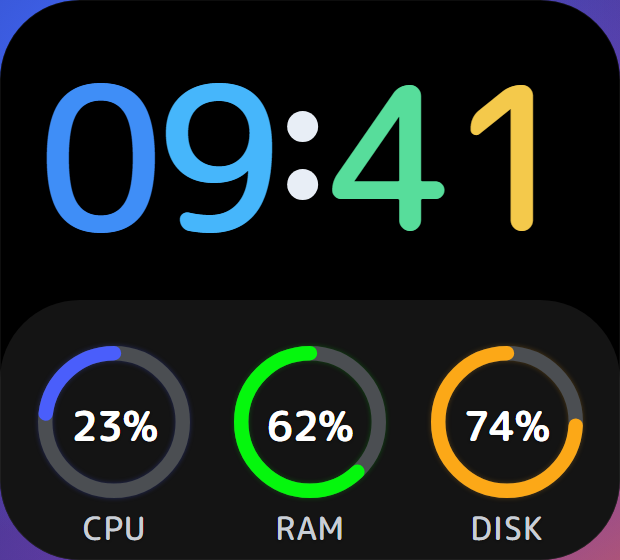
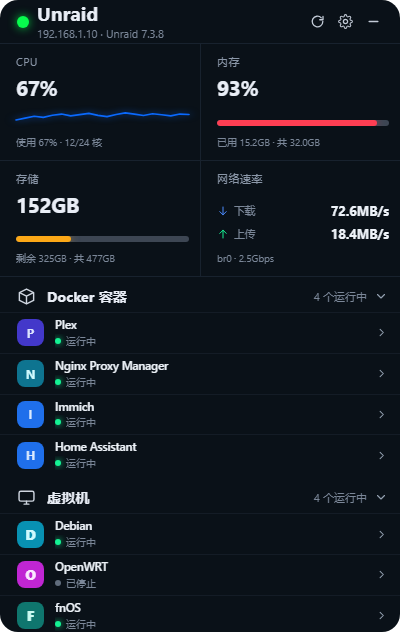
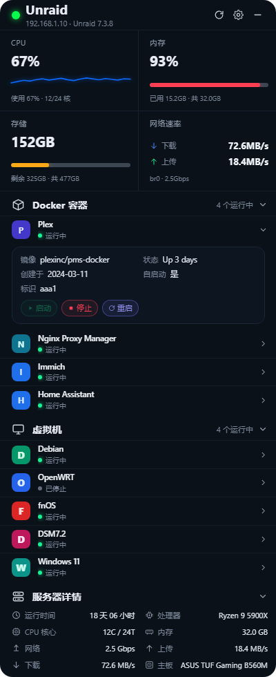
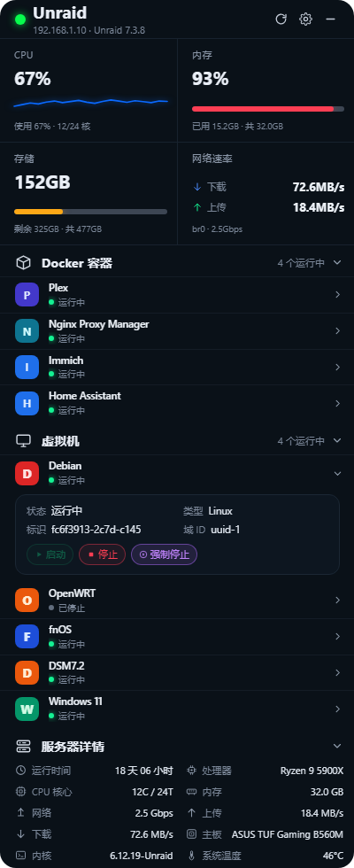
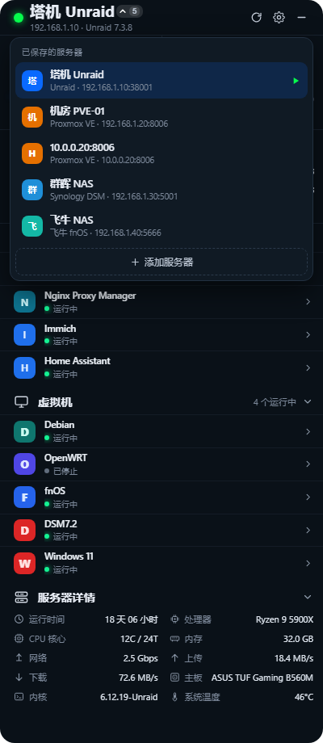
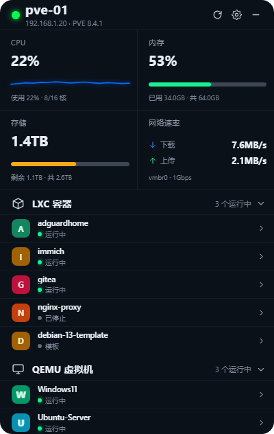
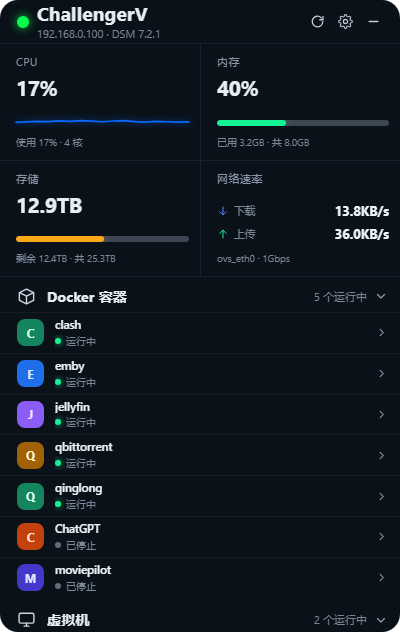
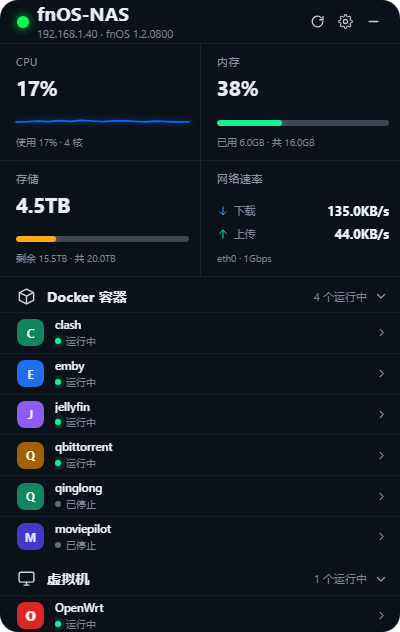
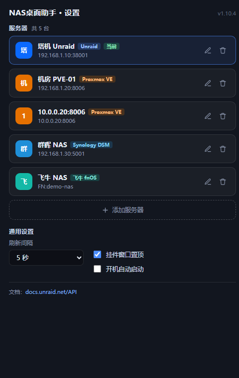
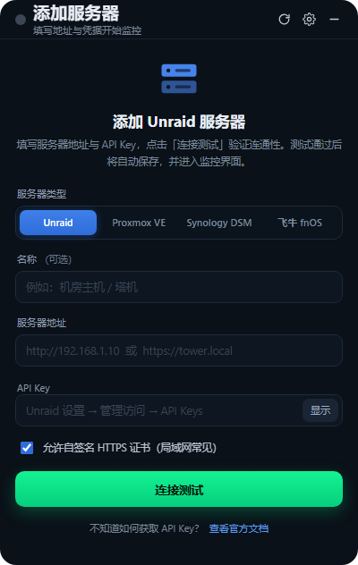

# NAS桌面助手

常驻桌面的 NAS / 服务器监控挂件（Windows · Electron），一个窗口同时盯住 **Unraid**、**Proxmox VE**、**Synology DSM**、**飞牛 fnOS** 四种系统，支持保存多台服务器并随时切换，可直接启停容器与虚拟机。

- **桌面组件**：时钟卡片（默认）或顶部简约条，托盘一键切换，两者共用同一份实时数据
- **详情面板**：CPU / 内存 / 存储 / 实时网络速率 2×2 总览，下方是容器、虚拟机与服务器详情
- **零运行时依赖**：只用 Electron 内置模块，WebSocket、HTTP、GraphQL、加密签名全部手写
- **开箱即用**：打包成单文件 exe，配置与窗口位置自动记住

> 本文截图均由仓库内置的 Mock 服务生成，**不含任何真实地址或凭据**。

## 截图

**时钟卡片（默认组件，155×140，4 倍放大）** —— 上半是本机时间，下半是所选服务器的 CPU / 内存 / 存储；单击展开详情，按住可拖动



**详情面板** —— 2×2 核心指标 + 容器 / 虚拟机 / 服务器详情



**展开容器条目即可启停**（虚拟机同理，多一个「强制停止」）




**多服务器切换** —— 标题栏箭头展开列表，四种类混用



**同一套界面，换服务器类型即换语义**（Proxmox VE → LXC / QEMU，DSM → 套件探测，fnOS → 加密 WebSocket）





**设置页 / 首次配置**




## 支持的服务器

| 类型 | 数据来源 | 凭据 | 容器 | 虚拟机 |
| --- | --- | --- | --- | --- |
| **Unraid** | GraphQL API（`http://<host>/graphql`，`x-api-key`） | API Key（需 ADMIN 角色） | Docker | KVM |
| **Proxmox VE** | REST API（`https://<host>:8006/api2/json`，`PVEAPIToken`） | API Token | LXC | QEMU |
| **Synology DSM** | WebAPI / CGI（`/webapi/entry.cgi`） | 账号密码（可带 2FA） | Docker 套件 | VMM 套件 |
| **飞牛 fnOS** | WebSocket RPC（RSA + AES + HMAC）＋虚拟机独立 REST | 账号密码，或**只填 FN ID** | Docker 应用 | 虚拟机应用 |

区块标题、字段与文案都会随当前服务器类型自动切换。

## 功能

### 桌面组件

| | 时钟卡片（默认） | 顶部简约条 |
| --- | --- | --- |
| 尺寸 | 155×140 | 274×56 |
| 内容 | 本机时间 + CPU / 内存 / 存储三环 | 三个环（标签在环下） |
| 位置 | 自由拖动，位置记忆 | 吸附屏幕顶端，只横向拖动 |
| 置顶 | 否 | 是 |
| 交互 | 单击展开 / 收起详情 | 同上 |

- 三个环从 12 点方向**逆时针**扫过，数值变化带缓动（`easeOutCubic`，650–700ms，不过冲）
- 环色：CPU `#4a5efb` / 内存 `#05f70d` / 存储 `#fca817`，轨道 `#4b4e52`
- 未配置或断连时数值降为 `—`，冒号变暗、环降亮度
- 托盘右键 →「组件样式」可在两者间切换；位置**分别记忆**（`topBounds` / `miniBounds`）

时钟卡片字体为 **M PLUS Rounded 1c**（SIL OFL 1.1，免费商用），已切成只含用到的字符的 woff2 子集随应用内嵌，离线可用。

### 详情面板

| 区块 | 内容 |
| --- | --- |
| 标题栏 | 状态点、服务器名、`IP · 版本`，右侧刷新 / 设置 / 收起 |
| 核心指标 2×2 | CPU（含近 48 次采样走势）、内存、存储、**实时上下行速率** |
| 容器 / 虚拟机 | 图标（没有则首字头像）、名称、状态；点开在上方以两列展示参数，下方是启停按钮 |
| 服务器详情 | 运行时间 · CPU · 核心 · 内存 · 网络 · 上传 · 下载 · 主板 · 内核 · 温度 |

三个区块的标题行都可点击折叠，折叠状态会记住。各区块独立请求、独立容错：例如 fnOS 没装虚拟机应用时，只有虚拟机区块提示不可用。

### 多服务器

- 服务器以卡片列表管理，点击即切换；当前只轮询选中的那台
- fnOS 的「服务器地址 / FN ID」是**同一个输入框**：内容含协议头或 `.` `:` 按地址直连，纯名称按 FN ID 走云端解析，输入框下方实时提示判路结果
- 旧版单服务器配置首次启动时自动迁移

## 快速开始

### 用打包好的 exe

从 Releases 下载 `NasAssistant-<版本>-x64-Setup.exe`（安装）或 `-Portable.exe`（免安装）。

> 未签名，Windows SmartScreen 可能提示「未知发布者」，选择「仍要运行」。

### 源码运行

```bash
npm install     # 首次会下载 Electron 运行时（约 100 MB+）
npm start
```

### 离线演示（无需真实服务器）

```bash
npm run mock        # 终端 A：Mock Unraid       http://127.0.0.1:8099
npm run mock:pve    #         Mock Proxmox VE   http://127.0.0.1:8098
npm run mock:dsm    #         Mock DSM          http://127.0.0.1:8098
npm run mock:fnos   #         Mock fnOS         ws://127.0.0.1:8099
npm start           # 终端 B
```

| 场景 | 该怎么填 |
| --- | --- |
| Unraid | 地址 `http://127.0.0.1:8099`，API Key 随便填 |
| Proxmox VE / DSM | 地址 `http://127.0.0.1:8098`（**必须显式写 `http://`**）；Token `root@pam!widget=demo-token-secret` 或账号 `admin` / `demo-pass` |
| 飞牛 fnOS | 地址 `127.0.0.1:8099`，账号 `admin` / `demo-pass`；或地址框填 FN ID `mocknas` 演练自动寻址 |

Mock 服务默认按各系统**真实线格**返回数据，并可模拟各种降级：`MOCK_MODE=legacy`（旧 Unraid 字段）、`MOCK_PVE_CLUSTER=1`、`MOCK_DSM_NO_DOCKER=1`、`MOCK_DSM_NO_VMM=1`、`MOCK_DSM_OTP=123456`、`MOCK_FNOS_REQUIRE_OTP=1`、`MOCK_FNOS_NO_VM=1`、`MOCK_FNOS_NO_DOCKER=1`。

fnOS 的 Mock 是一个真正的 WebSocket 服务端：现场生成 RSA 密钥对解密登录、并校验每条请求的 HMAC 签名 —— 自检跑通即证明协议实现正确，而不只是字段名对上。

## 首次配置

1. 选服务器类型（表单字段随之切换）
2. 填地址：Unraid 会自动补 `/graphql`；DSM 未写端口时 `https://` 补 5001、`http://` 补 5000；fnOS 默认 5666
3. 填凭据（见下）
4. 有自签名证书就勾选「允许自签名证书」
5. 点「连接测试」：失败会给出具体原因（如 `connect ETIMEDOUT`），通过则自动保存并进入监控

### 凭据怎么拿

- **Unraid**：设置 → 管理访问 → API Keys，角色选 **ADMIN**（只读角色能查不能启停）；命令行 `unraid-api apikey --create --name "widget" --roles ADMIN --json`
- **Proxmox VE**：数据中心 → 权限 → API 令牌。可整串填 `user@realm!tokenid=secret`，也可拆成「Token ID + secret」。读取需 `PVEAudit`，启停需 `VM.PowerMgmt`
- **Synology DSM / 飞牛 fnOS**：直接用账号密码（建议专为挂件建账号）。开启两步验证时，把当前 6 位验证码填进「两步验证码」；登录会话失效会自动重登

### 只填 FN ID 就能连（fnConnect）

飞牛 NAS 上「系统设置 → 远程访问 → FN Connect」里那串自命名 ID 就是 FN ID。只填它，挂件会向飞牛云端问出这台 NAS 的**全部**可达地址，再按当下网络环境自动选路：

```
局域网直连 → 公网 IPv4 → 公网 IPv6 → DDNS → FN Connect 中继
（同网段）   （做了映射）   （IPv6 可达） （自有域名）  （兜底）
```

- 探活用的是飞牛官方门户同一个探针页（`/static/bridge.html`），**按类别分组串行**：局域网命中就返回，不傻等超时（实测同网段 52ms）
- 结果缓存 5 分钟；连接失败立刻丢弃重解析（笔记本从公司带回家会自动从公网切回局域网）；解析失败缓存 30s，避免每 5 秒重试云端
- 中继（`<fnid>.fnos.net`）实测**只能跳门户、不能承载 WebSocket/REST**，仅作兜底；外网访问建议用 DDNS + 证书
- 不想用 FN ID 就直接填地址，行为与普通服务器一致；FN ID 解析失败时会退回手填地址

> 这个解析接口没有官方文档，是从 FN Connect 门户前端逆向出来的，两个签名头缺一不可。常量集中在 `src/fnos.js` 顶部，改动后跑 `npm run selftest:fnos`。

## 构建与自检

```bash
npm run dist              # NSIS 安装包 + 免安装 exe
npm run dist:portable     # 仅免安装版
npm run selftest          # 四种类型的端到端自检（全部走 Mock）
npm run selftest:fnos     # 也可单独跑：unraid / pve / dsm / fnos
npm run probe:fnos -- <地址> <账号> <密码>   # 真机只读探测，不改任何状态
```

自检不只校验字段名，还覆盖：加密登录与签名闭环、2FA、容器/虚拟机启停闭环、异步任务结果、会话失效重登、错误码文案、降级路径（未装套件 / 未装应用）、fnConnect 候选优先级与缓存。**签名会被 Mock 真校验** —— 故意传错 `apiKey` 必须得到 `invalid sign`，否则前几条断言可能是「服务端没验签」侥幸过的。

国内网络可加镜像后打包：

```bash
export ELECTRON_MIRROR=https://npmmirror.com/mirrors/electron/
export ELECTRON_BUILDER_BINARIES_MIRROR=https://npmmirror.com/mirrors/electron-builder-binaries/
export CSC_IDENTITY_AUTO_DISCOVERY=false
```

## 实现备注

四种系统各有各的坑，以下是实测校正后的结论（也是代码里首选查询的依据）。

### Unraid 7.x

服务端**禁用了 GraphQL introspection**，字段只能靠试探确定，所以代码里都做了候选回退。

| 用途 | 正确写法 |
| --- | --- |
| 版本号 | `info.versions.core.unraid` |
| 网卡 / 链路速率 | 根级 `networkInterfaces { name speed ipAddress operstate }` |
| 实时吞吐 / 温度 / 每核占用 | `metrics.network { rxSec txSec }`、`metrics.temperature`、`metrics.cpu.cpus` |
| 虚拟机列表 | `vms` 是对象，数组在 **`vms.domain`** |
| 容器变更 | 必须带子字段 `docker { start(id:"…") { id state } }`；**没有 `restart`**（用 stop + start） |
| 容器 ID | 直接用返回的 PrefixedID，自己拼前缀会找不到容器 |
| 阵列容量 | `capacity.kilobytes.*`；`capacity.disks.*` 是**槽位数量**不是容量 |

`VmDomain` 只返回 `id / uuid / name / state`，不提供图标与配置详情，所以虚拟机统一用「名称首字 + 随机底色」头像。

### Proxmox VE

- 地址**显式写 `http://` 必须保留**（否则会补成 https 导致 `EPROTO`）
- `status.cpu` 与 guest 的 `cpu` 都是 0..1，需 ×100；核数字段是 `cpus`
- `netin/netout` 已是字节/秒；`/status` 没有温度和主板
- 启停是**异步任务**：POST 返回 UPID，真实结果要轮询 `tasks/{upid}/status` 的 `exitstatus`

### Synology DSM

- 鉴权头 `sid` + `did`，body 带 `_sid`，会话约 12 小时
- **内存单位是 KB**（`sizeKb * 1024`），按 MB 算会差 1024 倍
- 错误码：102 套件未安装 / 105 权限不足 / 117 操作失败 / 119 会话失效
- `restart` 对已停止的容器会把它**启动**，不是空操作

### 飞牛 fnOS：三通道

| 通道 | 覆盖 | 要点 |
| --- | --- | --- |
| **WebSocket RPC** | 系统 / 资源 / 网络 / Docker | RSA + AES 混合加密登录，业务请求带 HMAC；签名后发的是 `sig + json` 拼接串，不是 JSON 对象。容器操作参数名固定 `containerId` |
| **HTTP REST** `/vm/api/v1` | 虚拟机 | 独立应用（`trim.vm`），走自己的 REST；`Authorization` 放**裸 token**（不带 `Bearer`）；列表里 `name` 是内部标识、`title` 才是展示名 |
| **fnConnect** | 云端寻址 | 只给 FN ID 时解析全部地址并选路 |

容易误判的一点：`hardware.vm.available` 描述的是**本机硬件虚拟化能力**（VT-x/VT-d），**不代表虚拟机应用装没装**。fnOS 自己跑在 QEMU 里且未开嵌套时会返回 `0`，但虚拟机照用 —— 判断装没装请看 `/vm/api/v1` 是否 404。WebSocket 侧的 `appcgi.(vmm|vm|virt).*` 一律返回 `266240`，属正常。

错误码：WS 侧 `266240` 无此模块 / `100000004` 无此方法 / `52428803` 缺参数 / `52428814` 找不到目标；REST 侧是另一套 `12xxx`（`12021` 找不到虚拟机、`12033` 当前状态不允许）。

## 常见问题

**只看到桌面组件，没有详情面板**
单击组件即展开；也可以右键托盘 → 勾选「详情面板」。若窗口被拖到屏幕外，删掉配置里的 `infoBounds` / `topBounds` / `miniBounds` 字段即可复位。

**启动报 `Cannot read properties of undefined (reading 'requestSingleInstanceLock')`**
终端里设了 `ELECTRON_RUN_AS_NODE=1`，Electron 被当成普通 Node 跑了。`unset ELECTRON_RUN_AS_NODE` 再启动。

**无显卡 / 远程桌面下白屏**
`npm start -- --disable-gpu --no-sandbox` 用软件渲染。

**鉴权失败（401/403）**
Unraid 的 Key 需要 ADMIN 角色；PVE 的 Token 需要 `PVEAudit`（读）与 `VM.PowerMgmt`（启停）；DSM / fnOS 需要在 Docker、虚拟机套件（应用）里有权限。

**「上传 / 下载」显示 `—`**
该版本没有实时吞吐字段，且无法用累计字节差分估算；此时「网络」一栏仍显示协商链路速率。

**改了组件尺寸后，内部字没跟着缩**
时钟卡片的内容基准宽 `--bw` 固定 160px（改窗口只改外框）；想让它随窗口等比缩放，把 `--bw` 改成 `var(--w)`。圆环直径、面板高度、贴底距离分别由 `--ring`、`--panelh`、`--gb` 控制。

## 目录结构

```
├── src/
│   ├── main.js              # 主进程：三窗口、托盘、轮询、IPC
│   ├── preload.js           # contextBridge
│   ├── store.js             # 配置持久化（v2 多服务器 + 旧配置迁移）
│   ├── provider.js / providers.js   # 类型元数据 + 按 type 路由
│   ├── unraid.js / proxmox.js / dsm.js / fnos.js   # 四种实现
│   ├── ws.js / http.js / format.js  # 零依赖 WebSocket、HTTP、格式化
│   └── renderer/            # top(时钟卡片) / mini(简约条) / widget(详情) / settings
├── tools/                   # 四个 Mock 服务、四套自检、fnOS 只读探测、图标生成
└── screenshots/             # README 截图（Mock 数据）
```

> 设计稿与宣传物料属于本地素材，不随仓库分发。

## 数据与隐私

- 凭据保存在本机 `%APPDATA%/unraid-desktop-widget/config.json`，**明文 JSON**，安全性取决于本机账户 —— 请勿把该文件外发或提交到仓库
- 所有请求都直连你自己的服务器，不经任何第三方；fnOS 只在「只填 FN ID」时访问飞牛云端做地址解析
- 仓库里的截图与 Mock 数据全部使用演示地址（`192.168.1.x`、`demo-nas` 等）

## 许可

MIT。第三方字体 M PLUS Rounded 1c 依 SIL Open Font License 1.1 分发。

参考文档：[Unraid API](https://docs.unraid.net/API/how-to-use-the-api/) · [Proxmox VE API](https://pve.proxmox.com/pve-docs/chapter-pveum.html) · [fnOS API 社区文档](https://fnosp.github.io/fnnas-api/) · [dsm_helper](https://github.com/ApaipaiLtd/dsm_helper)
